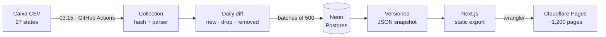

# Garimpo Imóveis

[](https://github.com/tarlisodoria/garimpo-imoveis/actions/workflows/ci.yml)
[](https://github.com/tarlisodoria/garimpo-imoveis/actions/workflows/coleta-diaria.yml)
[](LICENSE)

> Versão em português: [README.md](README.md)

A data pipeline that collects, every day, the official list of properties for sale by Caixa Econômica Federal (a Brazilian state-owned bank) across all 27 Brazilian states, detects new listings and price drops, and publishes a static website with the largest discounts by state and city.

**Website:** [garimpo-imoveis.pages.dev](https://garimpo-imoveis.pages.dev) (in Portuguese) · portfolio project, non-commercial and not affiliated with Caixa.

## The problem

Caixa publishes its list of properties for sale as one CSV file per state, with no history, no day-to-day comparison and no way to search by discount. Finding out what was added or got cheaper means downloading and comparing files by hand. This project automates that comparison and turns the result into browsable pages.

## How it works



1. **Collection:** a scheduled workflow downloads each state's CSV (one request per state per day). Files identical to the last processed one (same SHA-256) are skipped.
2. **Comparison:** each list is compared with the previous state; changes become events and price history in Postgres.
3. **Snapshot:** a JSON file with totals, top discounts and weekly price drops is generated and committed when it changes.
4. **Publishing:** Next.js builds static pages from the snapshot and Cloudflare Pages serves them. The website never queries the database.

Details (in Portuguese) in [docs/arquitetura.md](docs/arquitetura.md) and [docs/dados.md](docs/dados.md).

## Stack and rationale

| Layer         | Technology                              | Why                                                        |
| ------------- | --------------------------------------- | ---------------------------------------------------------- |
| Orchestration | GitHub Actions                          | free scheduling, logs and secrets, next to the code        |
| Database      | Neon (serverless Postgres, São Paulo)   | managed Postgres that does not pause on the free tier      |
| Data access   | Drizzle ORM + drizzle-kit               | end-to-end types and versioned SQL migrations              |
| Language      | TypeScript (Node 20, `tsx`)             | the same code runs locally and in CI                       |
| Website       | Next.js (`output: "export"`) + Tailwind | static pages per state and city, SEO-friendly              |
| Hosting       | Cloudflare Pages (Direct Upload)        | free CDN, no server, no credentials at the edge            |
| Quality       | `node:test`, ESLint, Prettier           | tests with no extra dependencies; formatting checked in CI |

Running cost: **zero** (free tiers only).

## Decisions

Technical decisions are recorded as ADRs (in Portuguese) in [docs/adr/](docs/adr/). The main ones:

- [0001](docs/adr/0001-site-estatico-a-partir-de-snapshot.md): static website built from a versioned snapshot, no database at runtime.
- [0003](docs/adr/0003-corte-da-carga-inicial.md): the first collection of each state does not count as "new".
- [0004](docs/adr/0004-persistencia-em-lotes.md): batched writes, with the collection marked as done only at the end.
- [0008](docs/adr/0008-modo-vitrine-sem-backend.md): no accounts, billing or code at the edge.

## Real problems solved

1. **A whole state went missing from the database.** Rio de Janeiro (8,053 rows) blew Drizzle's call stack in a single insert, after the collector had already marked the run as `success`. The next day the same file was treated as "unchanged", leaving the state with zero properties. Fix: batches of 500, `success` written only after persisting, every failure recorded, and the bad record corrected without deleting data. Rio was re-imported with 8,053 properties.
2. **Over 20,000 fake "new listings".** The first collection of a state creates a `new` event for its entire base: 13,711 in the first nationwide run and 8,053 for Rio. A per-state cutoff, with no schema change, separates the initial load from real new listings.
3. **HTTP 502 from the source.** Caixa sometimes answers 502. The failure is recorded, does not block the next attempt and opens an issue automatically; the file is reprocessed the next day.
4. **Suspicious 90% discounts.** 34 properties had discounts of exactly 90.00% or 90.01%. It is not rounding: the minimum sale price is 10% of the appraisal, for properties that went through auctions with no buyer. Highlights are now limited to 2 properties per city.
5. **List lagging behind the official page.** For some properties the sale type in the CSV differed from the official page; the CSV served on Oct 20 had been generated on Oct 16. Each card now shows the date of the list the data came from.
6. **Dates one day early.** `2026-10-16` formatted in the Brasília time zone became Oct 15. Date-only values are now formatted without a time zone, with a test.
7. **Formatting failing on Windows.** 75 of 76 `format:check` failures were CRLF line endings. A `.gitattributes` with `eol=lf` fixed it, and the check now runs in CI.

## Results

A reproducible analysis lives in [docs/resultados.md](docs/resultados.md), generated by `npm run analise` ([scripts/analise/](scripts/analise/)). With data from Oct 20, 2026:

- **21,992 active properties** in 27 states and 1,180 cities, with a median discount of **42.1%** off the appraisal. Rio de Janeiro holds 37% of the list (8,200 properties).
- In Santa Catarina and the Federal District the median discount is 0%: most properties are offered at the appraised value.
- **Repricing on Oct 20, 2026:** 3,931 price drops in a single day, 2,166 in Rio and 1,113 in Goiás, with a median drop of about 2.8% and BRL 9.7 million in combined reductions.

## Metrics

| Metric                | Value                                    |
| --------------------- | ---------------------------------------- |
| Monitored properties  | ~22,000 in 27 states                     |
| Full daily collection | ~5 min                                   |
| Build and deploy      | ~2 min                                   |
| Static pages          | 1,213 (6,087 files; Pages limit: 20,000) |
| Tests                 | 43, in 10 files                          |
| Code                  | ~3,400 lines of TypeScript               |
| Monthly cost          | BRL 0                                    |

## Running locally

Requirements: Node.js 20+ and npm 10+.

```bash
npm install
npm run dev        # website at http://localhost:3000, from the versioned snapshot
npm test           # tests
npm run build      # static website in out/
```

The website works without a database, from `data/public-snapshot.json`. To collect data and build the snapshot, create a Postgres database (for example on Neon) and a `.env` file with `DATABASE_URL` (see `.env.example`):

```bash
npm run db:migrate                       # create the tables
npx tsx scripts/coleta/run-coleta.ts PA  # collect one state
npm run public:snapshot                  # build the snapshot
npm run analise                          # regenerate docs/resultados.md
```

## Limitations

- Data depends on Caixa's list, which can lag days behind the official page. **Always check the source.**
- The price shown is the minimum sale price; in online auctions ("Venda Online") the final price may be higher.
- Collection does not retry automatically on temporary errors; the file is reprocessed the next day.
- History starts in October 2026, when monitoring began.
- 12 of 1,187 cities have no match in IBGE data (Federal District administrative regions, districts and spelling differences) and are shown without accents.

## License and data

The code is released under the [MIT License](LICENSE). Property data is public information published by Caixa Econômica Federal, and municipality names come from IBGE; they are not relicensed under MIT (see [docs/dados.md](docs/dados.md)). To cite this project, use [CITATION.cff](CITATION.cff).

## Author

Tarliso Dória · [github.com/tarlisodoria](https://github.com/tarlisodoria)
