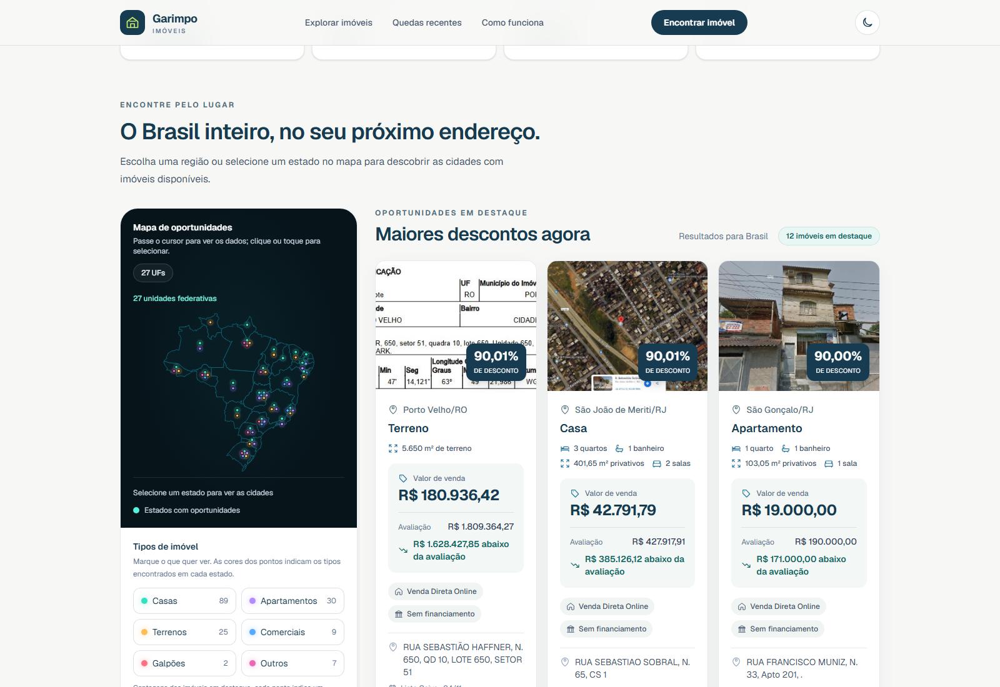
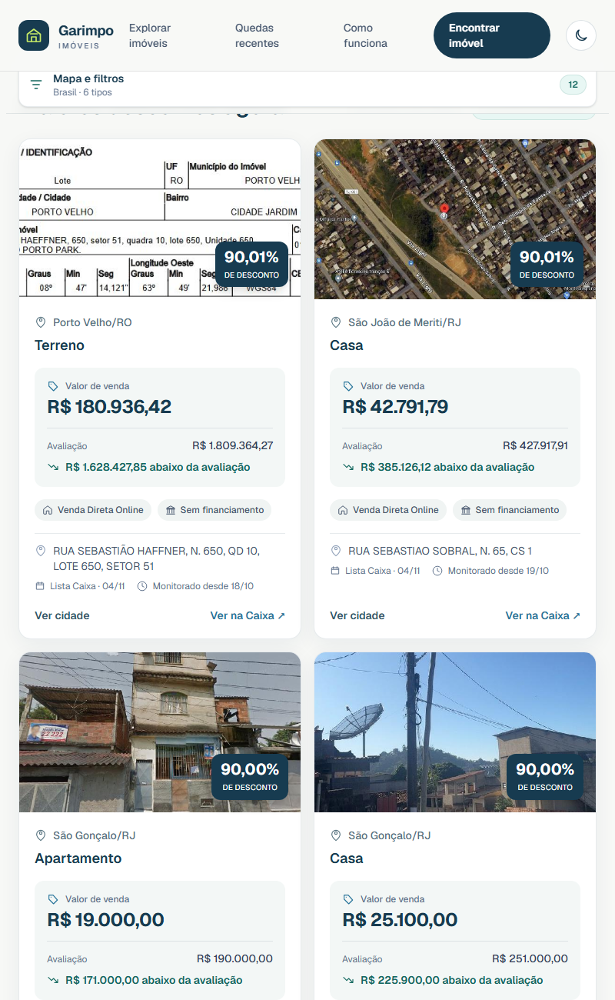
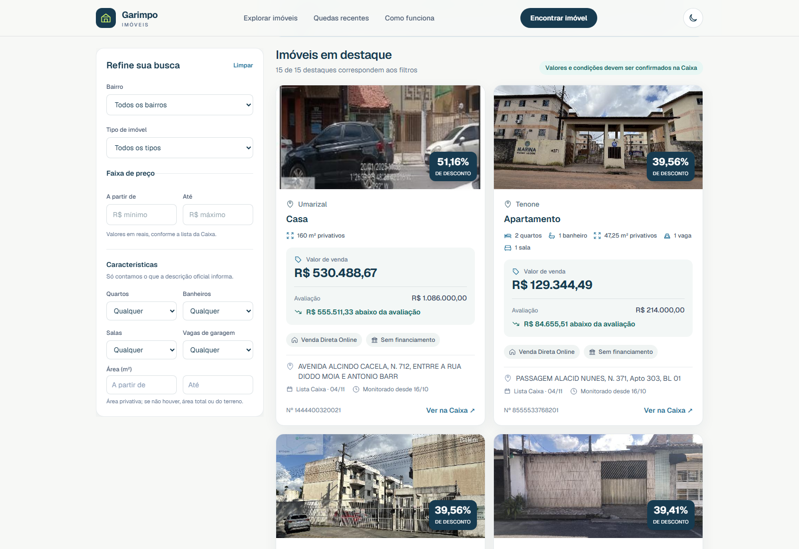
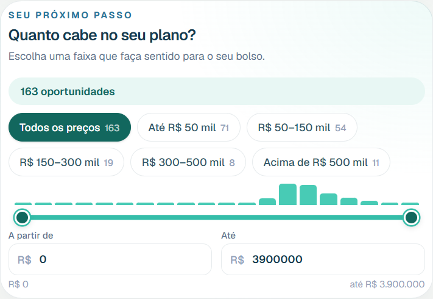
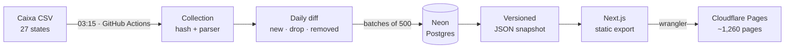

# Garimpo Imóveis









[](https://github.com/tarlisodoria/garimpo-imoveis/actions/workflows/ci.yml)
[](https://github.com/tarlisodoria/garimpo-imoveis/actions/workflows/coleta-diaria.yml)
[](LICENSE)

> Versão em português: [README.md](README.md)

A data pipeline that collects, every day, the official list of properties for sale by Caixa Econômica Federal (a Brazilian state-owned bank) across all 27 Brazilian states, detects new listings and price drops, and publishes a static website with the largest discounts by state and city.

**Website:** [garimpo-imoveis.pages.dev](https://garimpo-imoveis.pages.dev) (in Portuguese) · portfolio project, non-commercial and not affiliated with Caixa.

## The problem

Caixa publishes its list of properties for sale as one CSV file per state, with no history, no day-to-day comparison and no way to search by discount. Finding out what was added or got cheaper means downloading and comparing files by hand. This project automates that comparison and turns the result into browsable pages.

## What I built

I redesigned the showcase to make exploring opportunities more visual, straightforward and easier to use:

- **Side-by-side search:** on larger screens, the map and filters stay in a fixed sidebar while results scroll; on phones, a panel opens the map and filters without pushing the listings down.
- **Interactive map of Brazil:** select a region or state, browse its cities and update results by location.
- **Color-coded property types:** filter houses, apartments, land, warehouses, commercial properties and other types. Markers are grouped by state because the public list does not provide exact address coordinates.
- **Budget filter:** quick price ranges, a histogram of displayed listings, a progressive-scale minimum/maximum slider and editable numeric fields.
- **Property feature filters:** bedrooms, bathrooms, living rooms, parking spaces and area on the main search and state/city pages; local pages also filter by city or neighborhood when available.
- **Light and dark themes:** a header switch saves the preference in the browser.
- **Clearer listing cards:** sale price, appraisal and savings are emphasized; sale type, financing, address and dates use concise rows and small icons. Bedrooms, bathrooms, living rooms, parking spaces and areas also appear when explicitly listed by Caixa, with no estimates for missing details.
- **Online Sale countdown:** when the official Caixa page publishes an exact date and time, the card displays a countdown and notes that new bids may extend the deadline.
- **No repeated homepage cards:** listings already shown in the featured search are omitted from the recent price-drop section.
- **Official photos:** when Caixa makes an image available, it loads directly from the source. This project does not copy or host property photos.
- **State and city pages:** contextual navigation to continue exploring and review listed opportunities.

Search counts and cards use the featured listings included in the public snapshot, not the entire active Caixa catalog. Price, availability, auction notice, occupancy and terms can change; confirm them on each property's official page.

## Validation before publishing

Before publishing this version, I ran the tests on my local machine:

```bash
npm run lint
npm run format:check
npm test
npm run build
```

All 61 automated tests passed and the Next.js static build generated 1,262 HTML pages. I also checked the local version in the browser: feature and location filters, countdowns for listings with an official deadline, readable addresses and no repeated listings across homepage sections. The screenshots above were captured from the validated local site before committing and publishing to Cloudflare Pages.

Passing tests does not replace checking each property's terms on Caixa's official page.

## How it works



1. **Collection:** a scheduled workflow downloads each state's CSV (one request per state per day). Files identical to the last processed one (same SHA-256) are skipped.
2. **Comparison:** each list is compared with the previous state; changes become events and price history in Postgres.
3. **Snapshot:** a JSON file with totals, top discounts and weekly price drops is generated and committed when it changes.
4. **Publishing:** Next.js builds static pages from the snapshot and Cloudflare Pages serves them. The website never queries the database.

Details (in Portuguese) in [docs/arquitetura.md](docs/arquitetura.md) and [docs/dados.md](docs/dados.md).

## Stack and rationale

| Layer         | Technology                              | Why                                                                                   |
| ------------- | --------------------------------------- | ------------------------------------------------------------------------------------- |
| Orchestration | GitHub Actions                          | free scheduling, logs and secrets, next to the code                                   |
| Database      | Neon (serverless Postgres, São Paulo)   | does not pause the project for inactivity (unlike Supabase); it only suspends compute |
| Data access   | Drizzle ORM + drizzle-kit               | end-to-end types and versioned SQL migrations                                         |
| Language      | TypeScript (Node 20, `tsx`)             | the same code runs locally and in CI                                                  |
| Website       | Next.js (`output: "export"`) + Tailwind | static pages per state and city, SEO-friendly                                         |
| Hosting       | Cloudflare Pages (Direct Upload)        | free CDN, no server, no credentials at the edge                                       |
| Quality       | `node:test`, ESLint, Prettier           | tests with no extra dependencies; formatting checked in CI                            |

Running cost: **zero** (free tiers only).

## Decisions

Technical decisions are recorded as ADRs (in Portuguese) in [docs/adr/](docs/adr/). The main ones:

- [0001](docs/adr/0001-site-estatico-a-partir-de-snapshot.md): static website built from a versioned snapshot, no database at runtime.
- [0003](docs/adr/0003-corte-da-carga-inicial.md): the first collection of each state does not count as "new".
- [0004](docs/adr/0004-persistencia-em-lotes.md): batched writes, with the collection marked as done only at the end.
- [0008](docs/adr/0008-modo-vitrine-sem-backend.md): no accounts, billing or code at the edge.

## Real problems solved

1. **A whole state went missing from the database.** Rio de Janeiro (8,053 rows) blew Drizzle's call stack in a single insert, after the collector had already marked the run as `success`. The next day the same file was treated as "unchanged", leaving the state with zero properties. Fix: batches of 500, `success` written only after persisting, every failure recorded, and the bad record corrected without deleting data. Rio was re-imported with 8,053 properties.
2. **Over 20,000 fake "new listings".** The first collection of a state creates a `new` event for its entire base: 13,711 in the first nationwide run and 8,053 for Rio. A per-state cutoff, with no schema change, separates the initial load from real new listings.
3. **HTTP 502 from the source.** Caixa sometimes answers 502. The failure is recorded, does not block the next attempt and opens an issue automatically; the file is reprocessed the next day.
4. **Suspicious 90% discounts.** On the analysis date (Oct 20, 2026), 34 properties had discounts of exactly 90.00% or 90.01%. It is not rounding: the minimum sale price is 10% of the appraisal, for properties that went through auctions with no buyer. Highlights are now limited to 2 properties per city.
5. **List lagging behind the official page.** For some properties the sale type in the CSV differed from the official page; the CSV served on Oct 20 had been generated on Oct 16. Each card now shows the date of the list the data came from.
6. **Dates one day early.** `2026-10-16` formatted in the Brasília time zone became Oct 15. Date-only values are now formatted without a time zone, with a test.
7. **Formatting failing on Windows.** 75 of 76 `format:check` failures were CRLF line endings. A `.gitattributes` with `eol=lf` fixed it, and the check now runs in CI.

## Results

A reproducible analysis lives in [docs/resultados.md](docs/resultados.md), generated by `npm run analise` ([scripts/analise/](scripts/analise/)). With data from Oct 20, 2026:

- **21,992 active properties** in 27 states and 1,180 cities, with a median discount of **42.1%** off the appraisal. Rio de Janeiro holds 37% of the list (8,200 properties).
- In Santa Catarina and the Federal District the median discount is 0%: most properties are offered at the appraised value.
- **Repricing on Oct 20, 2026:** 3,931 price drops in a single day, 2,166 in Rio and 1,113 in Goiás, with a median drop of about 2.8% and BRL 9.7 million in combined reductions.

## Metrics

| Metric                | Value                                  |
| --------------------- | -------------------------------------- |
| Monitored properties  | ~22,000 in 27 states                   |
| Full daily collection | ~5 min                                 |
| Build and deploy      | ~2 min                                 |
| Static pages          | 1,262 HTML (Pages limit: 20,000 files) |
| Tests                 | 46, in 11 files                        |
| Code                  | ~5,300 lines of TypeScript             |
| Monthly cost          | BRL 0                                  |

## Running locally

Requirements: Node.js 20+ and npm 10+.

```bash
npm install
npm run dev        # website at http://localhost:3000, from the versioned snapshot
npm test           # tests
npm run build      # static website in out/
```

The website works without a database, from `data/public-snapshot.json`. To collect data and build the snapshot, create a Postgres database (for example on Neon) and a `.env` file with `DATABASE_URL` (see `.env.example`):

```bash
npm run db:migrate                       # create the tables
npx tsx scripts/coleta/run-coleta.ts PA  # collect one state
npm run public:snapshot                  # build the snapshot
npm run analise                          # regenerate docs/resultados.md
```

## Limitations

- Data depends on Caixa's list, which can lag days behind the official page. **Always check the source.**
- The price shown is the minimum sale price; in online auctions ("Venda Online") the final price may be higher.
- Collection does not retry automatically on temporary errors; the file is reprocessed the next day.
- History starts in October 2026, when monitoring began.
- 12 of 1,187 cities have no match in IBGE data (Federal District administrative regions, districts and spelling differences) and are shown without accents.

## Next steps

- Retry the CSV download on 5xx errors and timeouts, with exponential backoff and a circuit breaker so the workflow stays within its time limit.
- Integration tests against a Postgres instance in CI, covering collection, diff and persistence end to end.
- A public channel for the day's price drops (for example, an RSS feed generated at build time).

## License and data

The code is released under the [MIT License](LICENSE). Property data is public information published by Caixa Econômica Federal, and municipality names come from IBGE; they are not relicensed under MIT (see [docs/dados.md](docs/dados.md)). To cite this project, use [CITATION.cff](CITATION.cff).

The interactive map uses IBGE state boundaries distributed by [br-geojson](https://github.com/henriquemalvar/br-geojson) under CC0 1.0. Colored dots group featured listings by property type and state; they indicate approximate presence, not the exact address. The budget slider filters the showcase by price range with a progressive scale and quick presets. The header switch toggles between light and dark themes and saves the preference in the browser. When available, property card photos load directly from Caixa's official domain; image files are not copied into this project.

## Author

Tarliso Dória · [github.com/tarlisodoria](https://github.com/tarlisodoria) · [LinkedIn](https://www.linkedin.com/in/tarlisodoria)
