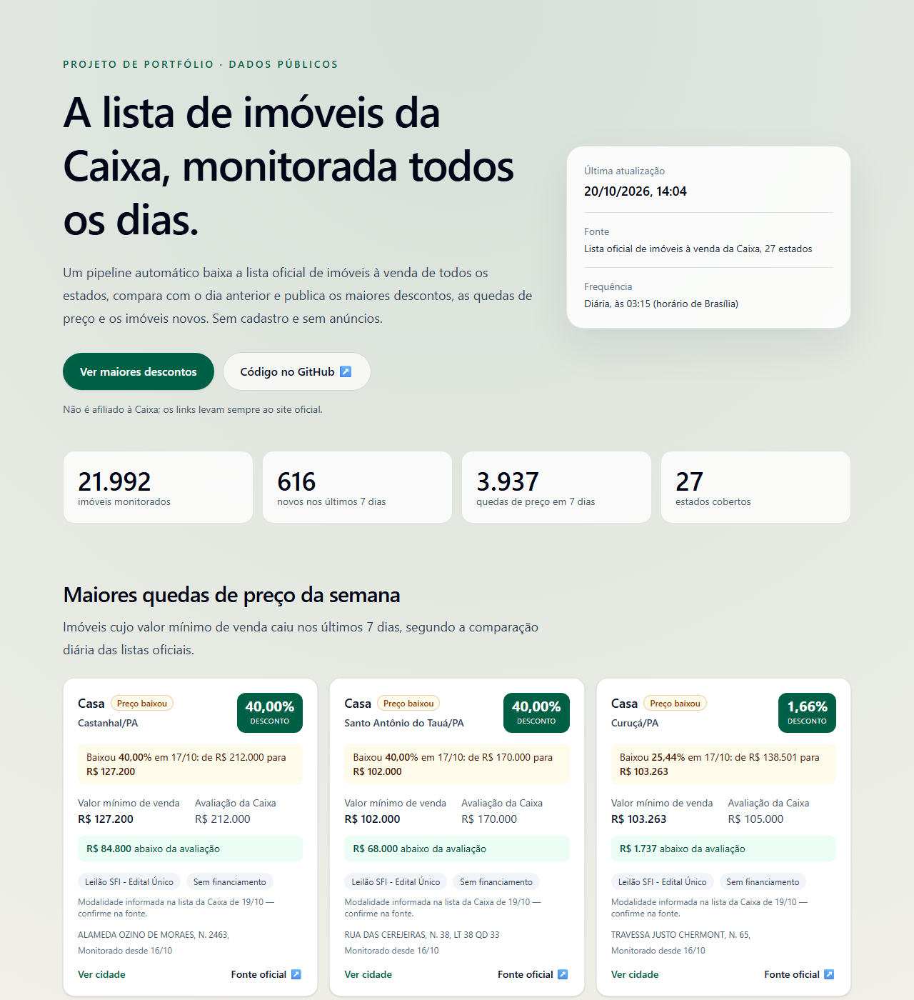
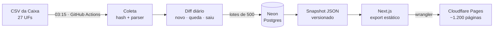

# Garimpo Imóveis



[](https://github.com/tarlisodoria/garimpo-imoveis/actions/workflows/ci.yml)
[](https://github.com/tarlisodoria/garimpo-imoveis/actions/workflows/coleta-diaria.yml)
[](LICENSE)

> English version: [README.en.md](README.en.md)

Pipeline de dados que coleta todos os dias a lista oficial de imóveis à venda da Caixa nas 27 UFs, detecta imóveis novos e quedas de preço e publica um site estático com os maiores descontos por estado e cidade.

**Site:** [garimpo-imoveis.pages.dev](https://garimpo-imoveis.pages.dev) · projeto de portfólio, sem fins comerciais e sem afiliação com a Caixa.

## O problema

A Caixa publica a lista de imóveis à venda como um CSV por estado, sem histórico, sem comparação entre dias e sem busca por desconto. Saber o que entrou na lista ou baixou de preço exige baixar e comparar arquivos manualmente. O projeto automatiza essa comparação e transforma o resultado em páginas navegáveis.

## Como funciona



1. **Coleta:** um workflow agendado baixa o CSV de cada UF (uma requisição por UF por dia). Arquivos iguais ao último processado (mesmo SHA-256) são ignorados.
2. **Comparação:** cada lista é comparada com o estado anterior; mudanças viram eventos e histórico de preço no Postgres.
3. **Snapshot:** um JSON com números, maiores descontos e quedas da semana é gerado e commitado quando muda.
4. **Publicação:** o Next.js gera páginas estáticas a partir do snapshot e o Cloudflare Pages as publica. O site não acessa o banco.

Detalhes em [docs/arquitetura.md](docs/arquitetura.md) e [docs/dados.md](docs/dados.md).

## Stack e motivos

| Camada         | Tecnologia                              | Por quê                                                                                  |
| -------------- | --------------------------------------- | ---------------------------------------------------------------------------------------- |
| Orquestração   | GitHub Actions                          | agendamento, logs e secrets gratuitos, no mesmo lugar do código                          |
| Banco          | Neon (Postgres serverless, São Paulo)   | não pausa o projeto por inatividade (diferente do Supabase); só suspende o processamento |
| Acesso a dados | Drizzle ORM + drizzle-kit               | tipagem de ponta a ponta e migrations SQL versionadas                                    |
| Linguagem      | TypeScript (Node 20, `tsx`)             | o mesmo código roda localmente e no CI                                                   |
| Site           | Next.js (`output: "export"`) + Tailwind | páginas estáticas por UF e cidade, boas para SEO                                         |
| Hospedagem     | Cloudflare Pages (Direct Upload)        | CDN gratuita, sem servidor e sem credenciais na borda                                    |
| Qualidade      | `node:test`, ESLint, Prettier           | testes sem dependências extras; formatação checada no CI                                 |

Custo de operação: **zero** (todos os serviços em planos gratuitos).

## Decisões

As decisões técnicas estão registradas como ADRs em [docs/adr/](docs/adr/). As principais:

- [0001](docs/adr/0001-site-estatico-a-partir-de-snapshot.md): site estático a partir de um snapshot versionado, sem banco em tempo de execução.
- [0003](docs/adr/0003-corte-da-carga-inicial.md): a primeira coleta de cada UF não conta como "novidade".
- [0004](docs/adr/0004-persistencia-em-lotes.md): gravação em lotes, com a coleta marcada como concluída só no fim.
- [0008](docs/adr/0008-modo-vitrine-sem-backend.md): sem contas, cobrança nem código na borda.

## Problemas reais resolvidos

1. **Uma UF inteira ficou fora do banco.** O RJ (8.053 linhas) estourou a pilha do Drizzle num insert único, e o coletor já tinha marcado a coleta como `sucesso`. No dia seguinte, o mesmo arquivo foi tratado como "sem alteração" e o RJ ficou com zero imóveis. Correção: lotes de 500, `sucesso` gravado só depois de persistir, toda falha registrada e o registro errado corrigido sem apagar dados. O RJ foi reimportado com 8.053 imóveis ([ADR 0004](docs/adr/0004-persistencia-em-lotes.md)).
2. **Mais de 20 mil "imóveis novos" falsos.** A primeira coleta de cada UF gera um evento `novo` para a base inteira: 13.711 na coleta nacional e 8.053 no RJ. Um corte por UF, sem mudar o schema, separa a carga inicial das novidades reais ([ADR 0003](docs/adr/0003-corte-da-carga-inicial.md)).
3. **Erro 502 da fonte.** A Caixa às vezes responde HTTP 502. A falha fica registrada, não bloqueia a próxima tentativa e abre uma issue automática; o arquivo é reprocessado no dia seguinte.
4. **Descontos de 90% suspeitos.** Na data da análise (20/10/2026), 34 imóveis tinham desconto de exatamente 90,00% ou 90,01%. A investigação mostrou que não é arredondamento: o valor mínimo de venda é 10% da avaliação, em imóveis que passaram por leilões sem comprador. Os destaques passaram a limitar 2 imóveis por cidade ([ADR 0007](docs/adr/0007-destaques-por-cidade-e-nomes-do-ibge.md)).
5. **Lista atrasada em relação à página oficial.** Para alguns imóveis, a modalidade do CSV diferia da página oficial. O CSV servido em 20/10 ainda era o gerado em 16/10. Cada card agora mostra a data da lista de onde vieram os dados.
6. **Datas um dia antes.** `2026-10-16` formatado com fuso de Brasília virava 15/10. Datas sem horário passaram a ser formatadas sem fuso, com teste.
7. **Formatação quebrando no Windows.** 75 de 76 falhas do `format:check` eram fim de linha CRLF. Um `.gitattributes` com `eol=lf` resolveu, e o check passou a rodar no CI.

## Resultados

Análise reproduzível em [docs/resultados.md](docs/resultados.md), gerada por `npm run analise` ([scripts/analise/](scripts/analise/)). Com os dados de 20/10/2026:

- **21.992 imóveis ativos** em 27 UFs e 1.180 cidades, com desconto mediano de **42,1%** sobre a avaliação. O RJ concentra 37% da lista (8.200 imóveis).
- Em SC e no DF, o desconto mediano é 0%: a maioria dos imóveis está à venda pelo valor de avaliação.
- **Reprecificação de 20/10/2026:** 3.931 quedas de preço num único dia, 2.166 no RJ e 1.113 em GO, com queda mediana de cerca de 2,8% e R$ 9,7 milhões de redução somada.

## Métricas

| Métrica                | Valor                                           |
| ---------------------- | ----------------------------------------------- |
| Imóveis monitorados    | ~22 mil, 27 UFs                                 |
| Coleta diária completa | ~5 min                                          |
| Build e deploy         | ~2 min                                          |
| Páginas estáticas      | 1.213 (6.087 arquivos; limite do Pages: 20.000) |
| Testes                 | 43, em 10 arquivos                              |
| Código                 | ~3.400 linhas de TypeScript                     |
| Custo mensal           | R$ 0                                            |

## Como rodar

Requisitos: Node.js 20+ e npm 10+.

```bash
npm install
npm run dev        # site em http://localhost:3000, usando o snapshot versionado
npm test           # testes
npm run build      # site estático em out/
```

O site funciona sem banco, a partir de `data/public-snapshot.json`. Para coletar e gerar o snapshot, crie um banco Postgres (por exemplo, no Neon) e um `.env` com `DATABASE_URL` (veja `.env.example`):

```bash
npm run db:migrate                     # cria as tabelas
npx tsx scripts/coleta/run-coleta.ts PA  # coleta uma UF
npm run public:snapshot                # gera o snapshot
npm run analise                        # regenera docs/resultados.md
```

## Limitações

- Os dados dependem da lista da Caixa, que pode atrasar dias em relação à página oficial. **Confirme sempre na fonte.**
- O valor exibido é o valor mínimo de venda; na Venda Online há disputa e o valor final pode ser maior.
- A coleta não repete o download automaticamente em caso de erro temporário; o arquivo é reprocessado no dia seguinte.
- O histórico começa em outubro de 2026, quando o monitoramento começou.
- 12 de 1.187 cidades não têm correspondência no IBGE (regiões administrativas do DF, distritos e grafias diferentes) e aparecem sem acento.

## Próximos passos

- Nova tentativa no download do CSV em erros 5xx e timeout, com espera exponencial e um disjuntor para não estourar o tempo do workflow.
- Testes de integração com um Postgres no CI, cobrindo coleta, diff e persistência de ponta a ponta.
- Canal público com as quedas de preço do dia (por exemplo, um feed RSS gerado no build).

## Licença e dados

O código está sob a [licença MIT](LICENSE). Os dados de imóveis são públicos, divulgados pela Caixa Econômica Federal, e os nomes de município vêm do IBGE; eles não são relicenciados pela MIT (veja [docs/dados.md](docs/dados.md)). Para citar o projeto, use [CITATION.cff](CITATION.cff).

## Autor

Tarliso Dória · [github.com/tarlisodoria](https://github.com/tarlisodoria) · [LinkedIn](https://www.linkedin.com/in/tarlisodoria)
