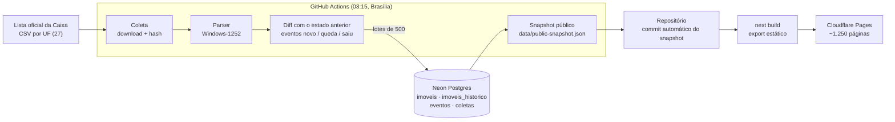

# Arquitetura

O Garimpo Imóveis é um pipeline de dados diário que termina num site estático. Não há servidor de aplicação: o banco só é acessado pela coleta, e o site lê um arquivo JSON gerado no build.

## Visão geral

## Etapas

### 1. Coleta (`scripts/coleta/run-coleta.ts`)

- Um workflow agendado (`coleta-diaria.yml`) aplica as migrations, roda os testes e coleta as 27 UFs em sequência: uma requisição por UF por dia.
- O arquivo é baixado e identificado por SHA-256. Se o hash for igual ao da última coleta **bem-sucedida** da UF, a coleta é registrada como `sem_alteracao` e nada mais é feito.
- Qualquer erro (HTTP 5xx da Caixa, falha de banco) fica registrado como `falha` em `coletas`; o arquivo é reprocessado na coleta seguinte. Uma falha no job abre uma issue automaticamente.

### 2. Parser (`scripts/coleta/caixa-csv.ts`)

- O CSV vem em Windows-1252, sem BOM, com uma linha de metadados ("Data de geração") e linhas vazias antes do cabeçalho.
- Valores monetários usam milhar com `.` e decimal com `,`; o desconto usa decimal com `.`. Todos os campos de texto são normalizados com `trim`.

### 3. Diff e persistência (`scripts/coleta/diff-imoveis.ts`, `persistencia.ts`)

- A lista nova é comparada com o estado atual da UF no banco e gera eventos `novo`, `queda_preco`, `mudou_modalidade` e `saiu`, além de linhas de histórico de preço.
- Toda gravação em massa vai em lotes de 500 (um insert único com milhares de linhas estourava a pilha do Drizzle).
- A linha `sucesso` em `coletas` só é gravada depois que todos os lotes foram persistidos, com o horário de início da coleta. Assim uma falha no meio nunca marca o arquivo como processado.

### 4. Snapshot (`scripts/public/generate-public-snapshot.ts`)

- Gera um JSON com os números gerais, os maiores descontos (global, por UF e por cidade), as maiores quedas da semana e a data da lista de cada UF.
- **Carga inicial:** a primeira coleta de cada UF gera um evento `novo` para todos os imóveis. Esses eventos são ignorados nas contagens de 7 dias e nos selos, usando como corte o início da coleta seguinte (ver [ADR 0003](adr/0003-corte-da-carga-inicial.md)).
- Os destaques têm no máximo 2 imóveis por cidade; nomes de município vêm do IBGE (`data/municipios-ibge.json`, versionado).
- O workflow commita o snapshot só quando ele muda e chama o deploy em seguida.

### 5. Site (`app/`, `components/`, `lib/`)

- Next.js com `output: "export"`: home, páginas por UF e por cidade (`generateStaticParams`), status, termos e privacidade.
- A busca exploratória recebe um recorte leve dos imóveis em destaque e os totais por UF/cidade, não o catálogo completo. O mapa SVG usa a malha estadual do IBGE; região e estado são selecionáveis e cada UF abre suas cidades.
- Em telas grandes, mapa e filtros ficam numa barra lateral sticky com rolagem própria; os resultados permanecem no fluxo principal. Em telas pequenas, um botão persistente abre o painel como diálogo modal, com foco controlado, fechamento por Escape e bloqueio da rolagem de fundo.
- Os filtros de tipo e de preço trabalham em conjunto sobre os imóveis em destaque. Os pontos coloridos indicam a presença de um tipo na UF, não coordenadas dos anúncios. A régua de orçamento usa escala logarítmica, histograma e limites numéricos; filtros e mapa são atualizados no navegador.
- A busca geral e as páginas de estado/cidade oferecem quartos, banheiros, salas, vagas e área como filtros mínimos/faixas, sempre com base nos campos explícitos da descrição. Nas páginas regionais, o filtro também considera tipo e preço; estado permite cidade e cidade permite bairro quando disponível. O painel regional informa que seus resultados são destaques limitados pelo snapshot.
- Na home, imóveis presentes no conjunto da busca principal são removidos da seção de quedas recentes para evitar que o mesmo anúncio apareça em dois blocos.
- Os cartões priorizam preço de venda, avaliação e diferença em reais. Modalidade e financiamento ficam como etiquetas; endereço e datas da lista/monitoramento aparecem separados, sem repetir em cada cartão o aviso sobre conferir as condições oficiais. O link direto para a Caixa continua visível.
- O botão de tema no cabeçalho salva a escolha claro/escuro em `localStorage`. O mapa mantém seu painel escuro e as linhas em destaque nos dois temas.
- Os cartões tentam carregar fotos do domínio oficial da Caixa diretamente, sem copiar as imagens para o repositório, e exibem alternativa quando a origem não disponibiliza a fotografia.
- Os cartões mostram características extraídas da descrição da Caixa (quartos, banheiros, salas, vagas e áreas) com ícones; só valores explícitos e positivos são exibidos. `WC` é contado como um banheiro, conforme a interpretação adotada na interface.
- A página do card pode incluir um cronômetro de Venda Online quando o snapshot registrou uma data/hora exata publicada pela Caixa. A geração consulta até 120 páginas oficiais por snapshot, com concorrência limitada; não cria prazo para anúncios sem data e sinaliza que a previsão pode ser prorrogada.
- Os indicadores de atualização e cobertura ficam mais próximos da grade de números para reduzir o espaço vertical entre os blocos do topo.
- Deploy por `wrangler pages deploy` (Direct Upload) no Cloudflare Pages, depois de `format:check` e build.

#### Limites da busca visual

O snapshot limita quantos imóveis detalhados são enviados à home; as contagens do orçamento, histograma, filtros e marcadores correspondem a esse recorte, não ao total de anúncios ativos. Os totais exibidos no mapa por estado e cidade vêm do snapshot completo agregado. Como a lista pública não informa latitude/longitude confiáveis por imóvel, os marcadores representam apenas a UF.

#### Verificação local da busca, filtros e cards

Antes desta publicação, executei em máquina local `npm run lint`, `npm run format:check`, `npm test` (61 testes), `npm run build` (1.262 páginas HTML) e `git diff --check`, todos sem falhas. Também conferi no navegador os filtros por localização e características, a apresentação do prazo oficial nos cards e a ausência de anúncios repetidos entre os destaques da home e as quedas recentes. As capturas atualizadas do README foram registradas a partir do site local.

## Segurança

- O site não tem Functions nem cadastro: nenhuma credencial fica na borda, e o banco não é acessível pela internet a partir do site.
- Os workflows usam só três secrets: `DATABASE_URL` (coleta) e `CLOUDFLARE_API_TOKEN`/`CLOUDFLARE_ACCOUNT_ID` (deploy). Host, endpoint e usuário do banco são mascarados nos logs, que são públicos.
- O token da Cloudflare tem escopo mínimo (`Cloudflare Pages: Edit`).

## Custos

Todos os serviços estão em planos gratuitos: GitHub Actions, Neon (Postgres serverless) e Cloudflare Pages (até 20.000 arquivos por deploy; o site usa cerca de 6.100).
